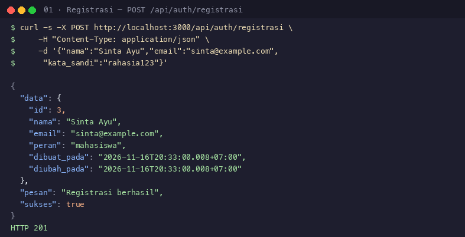
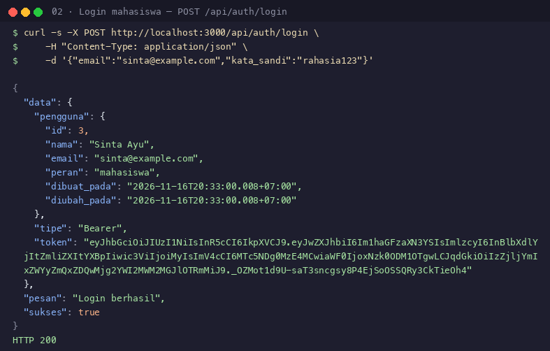
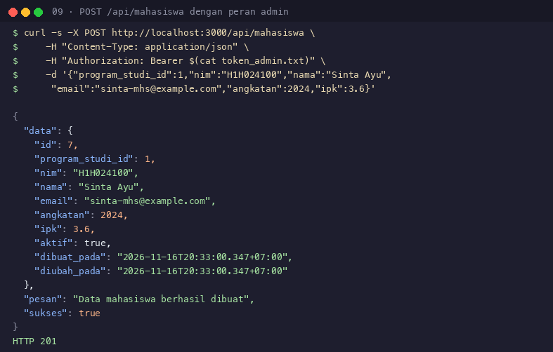
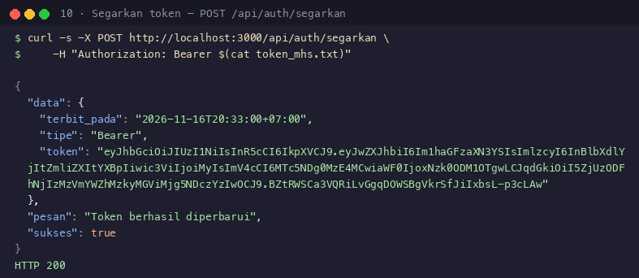
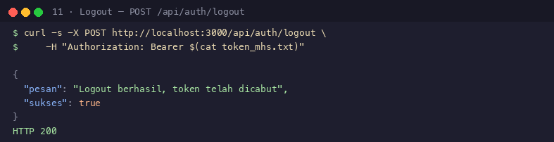
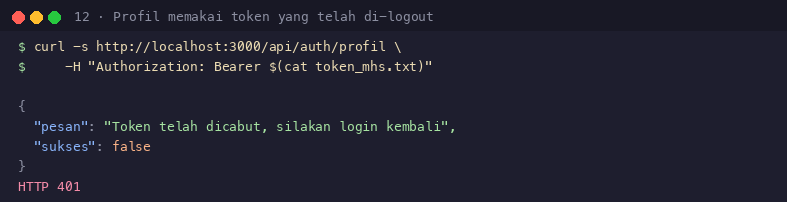
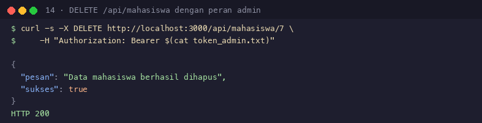
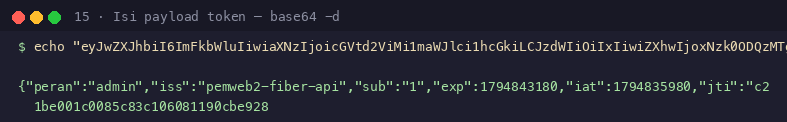

# TUGAS 8 VALIDASI, JWT, DAN PENANGANAN GALAT TERSTRUKTUR PADA FIBER

**PRAKTIKUM PEMROGRAMAN WEB II**

Muhammad Faiz Mubarok/H1H024051/B ke B

## Ringkasan Implementasi Modul

Sebelum mengerjakan tugas praktikum, seluruh langkah Langkah 1 sampai Langkah 13 pada modul dikerjakan terlebih dahulu pada proyek `latihan-fiber`:

| Komponen | Berkas | Isi |
|---|---|---|
| Konfigurasi JWT | `internal/config/config.go`, `.env` | Field `JwtSecret` dan `JwtTtlMenit`, variabel `JWT_SECRET` dan `JWT_TTL_MENIT` |
| Model pengguna | `internal/model/pengguna.go` | Struct `Pengguna`; kolom `KataSandi` diberi tag `json:"-"` agar tidak pernah terkirim |
| Utilitas token | `internal/auth/token.go` | `TerbitkanToken` (HS256, klaim `sub`, `iat`, `exp`, `iss`, `jti`) dan `PeriksaToken` |
| Validator | `internal/validasi/validasi.go` | Pembungkus `go-playground/validator/v10` dengan pesan galat berbahasa Indonesia |
| Handler autentikasi | `internal/handler/auth_handler.go` | `Registrasi`, `Login`, `Profil` (kata sandi di-hash bcrypt) |
| Middleware | `internal/middleware/autentikasi.go` | `Autentikasi()` (memeriksa header `Authorization: Bearer`) dan `HanyaPeran(...)` |
| Rute | `internal/router/router.go` | Rute publik `registrasi`/`login`, rute terlindungi, dan rute berbasis peran |
| Penangan galat | `cmd/api/main.go` | Respons selalu memuat kunci `sukses` dan `pesan`; galat internal dicatat ke log server |

## Tugas Praktikum

### 1. Endpoint POST /api/auth/segarkan

Endpoint `segarkan` diletakkan pada grup terlindungi sehingga hanya bisa diakses dengan token yang masih berlaku. Identitas dan peran diambil dari data yang sudah ditanam middleware autentikasi pada `c.Locals`, lalu token baru diterbitkan dengan `auth.TerbitkanToken`.

```go
// internal/handler/auth_handler.go
func Segarkan(c fiber.Ctx) error {
    idPengguna, cocokId := c.Locals("id_pengguna").(uint)
    peran, cocokPeran := c.Locals("peran").(string)

    if cocokId == false || cocokPeran == false {
        return fiber.NewError(fiber.StatusUnauthorized, "Konteks autentikasi tidak ditemukan")
    }

    konf := config.Muat()

    token, err := auth.TerbitkanToken(idPengguna, peran, konf.JwtSecret, konf.JwtTtlMenit)
    if err != nil {
        return fiber.NewError(fiber.StatusInternalServerError, "Gagal menerbitkan token")
    }

    return c.JSON(fiber.Map{
        "sukses": true,
        "pesan":  "Token berhasil diperbarui",
        "data": fiber.Map{
            "token": token,
            "tipe":  "Bearer",
            "terbit_pada": time.Now().Format(time.RFC3339),
        },
    })
}
```

Pendaftaran rute:

```go
terlindungi.Post("/auth/segarkan", handler.Segarkan)
```

Hasil uji: request tanpa token ditolak `401`, request dengan token sah mengembalikan `200` beserta token baru dengan klaim `iat` (waktu terbit) yang diperbarui.

```json
{"data":{"terbit_pada":"2026-11-16T20:05:48+07:00","tipe":"Bearer",
"token":"eyJhbGciOiJIUzI1NiIs..."},"pesan":"Token berhasil diperbarui","sukses":true}
```

### 2. Aturan validasi kustom NIM

Aturan kustom didaftarkan pada `init()` paket `validasi` dengan nama tag `nim`. Pola yang dipakai adalah `^H[0-9]+` (diawali huruf H lalu minimal satu angka). Pola `^H[0-9]+$` (hanya angka setelah H) sengaja tidak dipakai karena akan menolak NIM UNSOED asli seperti `H1H024051` yang memuat huruf H kedua di tengah.

```go
// internal/validasi/validasi.go
var polaNim = regexp.MustCompile(`^H[0-9]+`)

func init() {
    pemeriksa.RegisterValidation("nim", func(fl validator.FieldLevel) bool {
        return polaNim.MatchString(fl.Field().String())
    })
}
```

Aturan dipasang pada DTO beserta pesan khususnya:

```go
Nim string `json:"nim" validate:"required,min=5,max=20,nim"`
```

```go
case "nim":
    return "NIM harus diawali huruf H diikuti angka"
```

Hasil uji:

| NIM yang dikirim | Hasil |
|---|---|
| `H1H024051` (valid) | `201` — data tersimpan |
| `A1H024099` | `422` — `"NIM harus diawali huruf H diikuti angka"` |
| `HX` | `422` — ditolak aturan `min=5` |

```json
{"galat":[{"field":"Nim","pesan":"NIM harus diawali huruf H diikuti angka"}],
"pesan":"Data yang dikirim tidak valid","sukses":false}
```

### 3. Tabel daftar hitam token untuk logout

JWT bersifat stateless sehingga server tidak menyimpan token. Agar logout dapat mencabut token sebelum kedaluwarsa, ditambahkan:

1. **Klaim `jti`** — setiap token diberi penanda unik (ID acak 16 byte) melalui field `ID` pada `jwt.RegisteredClaims`.
2. **Model daftar hitam** — `internal/model/token_daftar_hitam.go`:

```go
type TokenDaftarHitam struct {
    ID         uint      `gorm:"primaryKey" json:"id"`
    Jti        string    `gorm:"size:64;uniqueIndex" json:"jti"`
    Kadaluarsa time.Time `json:"kadaluarsa"`
    CreatedAt  time.Time `json:"dibuat_pada"`
}
```

3. **Pemeriksaan pada middleware** — setelah tanda tangan token sah, middleware menolak token yang `jti`-nya sudah terdaftar:

```go
if klaim.ID != "" {
    var jumlah int64
    config.DB.Model(&model.TokenDaftarHitam{}).Where("jti = ?", klaim.ID).Count(&jumlah)
    if jumlah > 0 {
        return fiber.NewError(fiber.StatusUnauthorized, "Token telah dicabut, silakan login kembali")
    }
}
```

4. **Handler logout** — `POST /api/auth/logout` memasukkan `jti` token aktif beserta waktu kedaluwarsanya ke tabel. Entri dibiarkan punya waktu kedaluwarsa sama dengan token sehingga bisa dibersihkan berkala tanpa memengaruhi token lain.

Hasil uji alur lengkap:

| Langkah | Hasil |
|---|---|
| `POST /api/auth/logout` dengan token aktif | `200` — "Logout berhasil, token telah dicabut" |
| `GET /api/auth/profil` memakai token yang sama | `401` — "Token telah dicabut, silakan login kembali" |
| `GET /api/auth/profil` dengan token hasil `segarkan` | `200` — token lain tidak ikut tercabut |

### 4. Analisis perbandingan autentikasi Modul 5 (Laravel Sanctum) dan Modul 8 (Fiber + JWT)

Implementasi Modul 5 pada proyek `latihan-laravel` memakai Laravel Sanctum; implementasi Modul 8 pada proyek `latihan-fiber` memakai JWT buatan sendiri. Perbandingan diukur dari kode yang ditulis sendiri untuk fitur yang setara (registrasi, login, profil, logout, dan proteksi peran).

| Aspek | Modul 5 — Laravel Sanctum | Modul 8 — Fiber + JWT |
|---|---|---|
| Jumlah kode inti | ± 184 baris (`AuthController.php` 149 + `routes/api.php` 35) | ± 432 baris (`auth_handler.go` 182, `token.go` 74, `autentikasi.go` 72, `validasi.go` 65, `router.go` 39) |
| Penerbitan token | Satu baris: `$user->createToken('api')->plainTextToken` | Dibuat sendiri: struktur klaim, penandatanganan HS256, `strconv` untuk `sub`, ± 40 baris |
| Verifikasi token | Satu middleware bawaan `auth:sanctum`, verifikasi lewat basis data | Middleware sendiri: memecah header, `jwt.ParseWithClaims`, cek metode HMAC, cek daftar hitam |
| Validasi masukan | Bawaan: `$request->validate([...])` dengan pesan otomatis | Pustaka pihak ketiga `validator/v10` + penerjemah pesan sendiri |
| Otorisasi peran | `ability:mahasiswa:tulis` bawaan Sanctum + middleware `peran.admin` buatan | Middleware `HanyaPeran("admin","dosen")` buatan sendiri |
| Hash kata sandi | Bawaan `Hash::make()` / `Hash::check()` | `golang.org/x/crypto/bcrypt` dipasang manual |
| Pencabutan token | Hapus baris di tabel `personal_access_tokens`; `logout-semua` trivial | Perlu tabel daftar hitam sendiri + pemeriksaan di setiap request |
| Kecepatan verifikasi | Perlu akses basis data setiap request | Cukup cek tanda tangan, tanpa basis data (kecuali daftar hitam aktif) |
| Fleksibilitas | Terikat ekosistem Laravel dan satu basis data | Token dapat diverifikasi layanan mana pun yang memegang `JWT_SECRET` (sistem terdistribusi/microservice) |

**Analisis.** Dari sisi jumlah kode dan kemudahan, Sanctum jauh lebih ringkas karena hampir semua kebutuhan (penerbitan, verifikasi, pencabutan, ability) sudah disediakan kerangka kerja; pengembang hanya menulis controller dan rute. Pada Fiber, semua lapisan itu harus dibangun sendiri sehingga kodenya kira-kira 2 sampai 3 kali lipat, tetapi justru di situ terlihat cara kerja JWT secara eksplisit. Dari sisi fleksibilitas, JWT unggul pada arsitektur terdistribusi: token bisa diperiksa oleh layanan lain tanpa berbagi basis data, sedangkan Sanctum mensyaratkan semua layanan mengakses tabel token yang sama. Sebaliknya, untuk pencabutan segera, Sanctum lebih mudah karena cukup menghapus satu baris; JWT membutuhkan tambahan daftar hitam yang membuat verifikasi kembali memerlukan basis data. Kesimpulannya: Sanctum cocok untuk aplikasi monolit yang butuh cepat jadi dan pencabutan mudah; JWT cocok untuk API terdistribusi yang menuntut verifikasi cepat dan independen dari basis data.

## Hasil Pengujian

Screenshot berikut diambil dari pengujian langsung terhadap API. Pengujian memakai dua pengguna: `sinta@example.com` (peran mahasiswa, hasil registrasi) dan `fajar@example.com` (peran admin, diperbarui melalui basis data).

Gambar 1. POST `/api/auth/registrasi` pengguna baru Sinta Ayu (201)



Gambar 2. POST `/api/auth/login` kredensial benar (200) — respons memuat data pengguna dan token Bearer



Gambar 3. POST `/api/auth/login` kata sandi salah (401) — pesan selalu umum, tidak membocorkan bagian yang salah


Gambar 4. GET `/api/auth/profil` dengan token (200)


Gambar 5. GET `/api/auth/profil` tanpa token (401)


Gambar 6. POST `/api/mahasiswa` body tidak lengkap (422) — respons memuat daftar galat per field


Gambar 7. POST `/api/mahasiswa` NIM `A1H024099` (422) — aturan kustom `nim` bekerja


Gambar 8. POST `/api/mahasiswa` dengan token peran mahasiswa (403) — middleware `HanyaPeran` menolak sebelum handler


Gambar 9. POST `/api/mahasiswa` dengan token peran admin (201)



Gambar 10. POST `/api/auth/segarkan` dengan token sah (200) — token baru diterbitkan



Gambar 11. POST `/api/auth/logout` (200) — `jti` token dicatat ke daftar hitam



Gambar 12. GET `/api/auth/profil` memakai token yang telah di-logout (401)



Gambar 13. DELETE `/api/mahasiswa/6` dengan token peran mahasiswa (403)


Gambar 14. DELETE `/api/mahasiswa/6` dengan token peran admin (200)



Gambar 15. Isi payload token diuraikan dengan `base64 -d` — klaim `peran`, `iss`, `sub`, `exp`, `iat`, `jti` terbaca tanpa kunci apa pun



| No | Skenario | Status |
|---|---|---|
| 1 | `POST /api/auth/registrasi` pengguna baru | `201` |
| 2 | `POST /api/auth/login` kredensial benar | `200` + token Bearer |
| 3 | `POST /api/auth/login` kata sandi salah | `401`, pesan umum |
| 4 | `GET /api/auth/profil` dengan token | `200` |
| 5 | `GET /api/auth/profil` tanpa token | `401` |
| 6 | `POST /api/mahasiswa` body tidak lengkap | `422` + daftar galat per field |
| 7 | `POST /api/mahasiswa` NIM tidak diawali H | `422` + aturan kustom `nim` |
| 8 | `POST /api/mahasiswa` dengan peran mahasiswa | `403` |
| 9 | `POST /api/mahasiswa` dengan peran admin/dosen | `201` |
| 10 | `POST /api/auth/segarkan` token sah | `200` + token baru |
| 11 | `POST /api/auth/logout` | `200` |
| 12 | Token hasil logout dipakai ulang | `401` telah dicabut |
| 13 | `DELETE /api/mahasiswa/:id` oleh mahasiswa | `403` |
| 14 | `DELETE /api/mahasiswa/:id` oleh admin | `200` |
| 15 | Payload token diuraikan `base64 -d` | Klaim `peran`, `iss`, `sub`, `exp`, `iat`, `jti` terbaca |

Uraian payload (Gambar 15) memperlihatkan bahwa isi token hanya dikodekan Base64Url, bukan dienkripsi:

```json
{"peran":"admin","iss":"pemweb2-fiber-api","sub":"1","exp":1794841560,"iat":1794834360,
"jti":"19be74fc9a3cf017178357c66c439c38"}
```

## Catatan Perbaikan terhadap Snippet Modul

1. **Urutan middleware dan handler.** Snippet modul menuliskan `mahasiswa.Post("/", handler.BuatMahasiswa, middleware.HanyaPeran(...))`. Pada Fiber, handler dieksekusi berurutan; `BuatMahasiswa` mengembalikan respons tanpa memanggil `c.Next()`, sehingga `HanyaPeran` tidak pernah tereksekusi dan pengguna berperan mahasiswa dapat membuat data (terbukti saat pengujian). Implementasi ini menukar urutannya menjadi middleware lebih dulu: `mahasiswa.Post("/", middleware.HanyaPeran("admin", "dosen"), handler.BuatMahasiswa)`.
2. **Pola NIM.** Aturan `^H[0-9]+$` akan menolak NIM UNSOED asli seperti `H1H024051`; dipakai pola `^H[0-9]+` yang tetap memenuhi ketentuan "diawali huruf H diikuti angka".

## Pertanyaan Pembahasan

### 1. Mengapa bcrypt lebih sesuai untuk kata sandi dibandingkan fungsi hash cepat seperti SHA-256?

SHA-256 dirancang untuk memproses data secepat mungkin — jutaan hash per detik pada GPU — sehingga serangan brute force terhadap kata sandi yang di-hash SHA-256 sangat murah. bcrypt justru sengaja dibuat lambat: iterasinya diulang sebanyak `cost` (12 di `bcrypt.DefaultCost` berarti 2^12 putaran) dan memakai memori sehingga sulit dipercepat dengan GPU. bcrypt juga otomatis menyisipkan salt acak ke dalam hash, sehingga dua pengguna dengan kata sandi sama menghasilkan hash berbeda dan serangan tabel (rainbow table) tidak berguna. Karena itu untuk kata sandi yang lemah karena dipilih manusia, fungsi yang lambat dan bernahas seperti bcrypt jauh lebih aman daripada fungsi hash cepat.

### 2. Apa konsekuensi apabila nilai JWT_SECRET bocor?

Siapa pun yang memegang `JWT_SECRET` dapat menandatangani token palsu kapan saja: ia bisa membuat token dengan `sub` milik pengguna mana pun (misalnya admin) dan `peran` sesuka hati, lalu semua server akan menerimanya sebagai sah karena tanda tangannya valid. Ia juga dapat mengubah klaim token yang sah — misalnya menaikkan `exp` agar tidak kedaluwarsa atau mengubah `peran` menjadi `admin` — lalu menandatanganinya ulang. Karena JWT tidak menyimpan status di server, tidak ada cara membedakan token buatan penyerang dari token asli kecuali kunci diganti. Konsekuensinya adalah kebocoran total sistem: satu-satunya penanganan adalah mengganti kunci, yang otomatis membatalkan seluruh token pengguna yang sah, lalu mengaudit penyalahgunaan yang sudah terjadi. Karena itu kunci harus panjang, acak, tidak pernah masuk repositori (diletakkan pada `.env` yang diabaikan git), dan hanya dibagikan ke layanan yang benar-benar membutuhkan.

### 3. Mengapa penerapan logout pada JWT memerlukan usaha tambahan dibandingkan token tersimpan?

Pada token tersimpan (Sanctum), token hanyalah baris di tabel `personal_access_tokens`, sehingga logout cukup menghapus baris itu; request berikutnya otomatis gagal karena pencarian token tidak menemukan apa pun. Pada JWT tidak ada status di server: token sah akan tetap sah sampai `exp`-nya lewat, dan itu justru keunggulannya (verifikasi tanpa basis data). Untuk mencabut token sebelum kedaluwarsa, server harus mulai menyimpan keadaan lagi — persis hal yang coba dihindari JWT. Cara umumnya adalah daftar hitam: setiap request yang mencabut (logout) memasukkan penanda token (klaim `jti`) ke tabel, dan middleware memeriksa tabel itu setiap request. Usaha tambahannya nyata: tabel baru, pemeriksaan basis data tambahan per request (menurunkan keunggulan tanpa basis data), dan pembersihan entri yang sudah kedaluwarsa agar tabel tidak membengkak. Alternatif lain seperti masa berlaku pendek plus refresh token, atau rotasi kunci, sama-sama menambah kompleksitas. Inilah trade-off yang terlihat langsung pada Tugas 3.

### 4. Jelaskan alasan pesan login gagal sebaiknya tidak menyebutkan apakah email atau kata sandi yang salah.

Jika server memberi tahu bagian mana yang salah, penyerang dapat memanfaatkannya untuk mengumpulkan data: pesan "email tidak ditemukan" versus "kata sandi salah" disebut *user enumeration* — penyerang mencoba daftar email dan dari perbedaan pesan mengetahui email mana yang terdaftar di sistem. Setelah itu penyerang cukup fokus mencoba kata sandi pada akun-akun yang sudah pasti ada, dan saat uji kata sandi tahu persis bahwa satu faktor sudah benar. Dengan pesan umum "Email atau kata sandi tidak sesuai" untuk kedua kasus, setiap kegagalan terlihat identik sehingga penyerang tidak memperoleh informasi apa pun dari perbedaan respons. Praktik ini juga diterapkan pada implementasi: `Registrasi` dan `Login` memakai satu pesan yang sama, dan sebaiknya waktu respons kedua kasus juga diseragamkan (pemeriksaan hash tetap dijalankan meski email tidak ditemukan) agar tidak bocor lewat perbedaan kecepatan respons.
