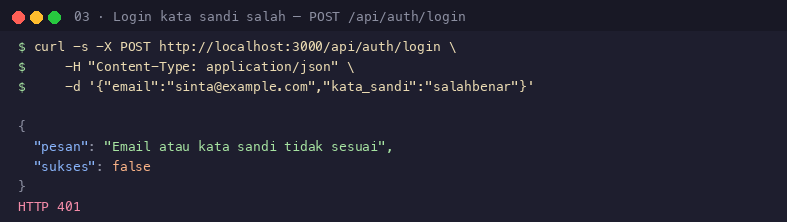
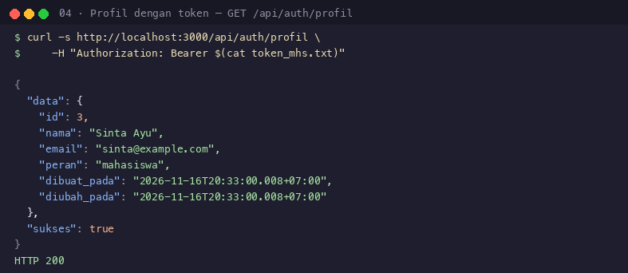
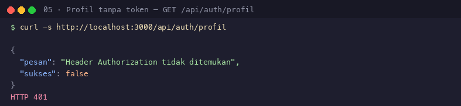
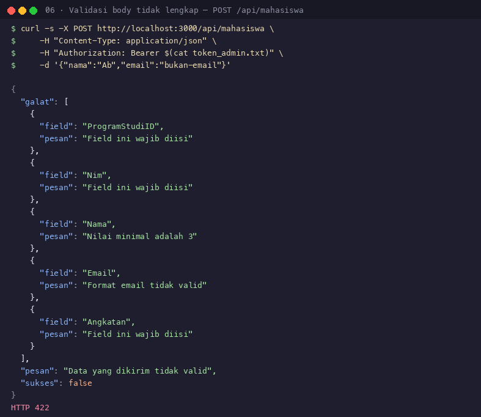
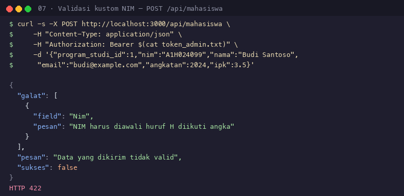
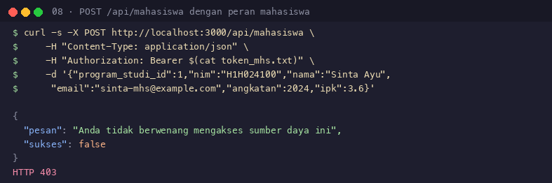
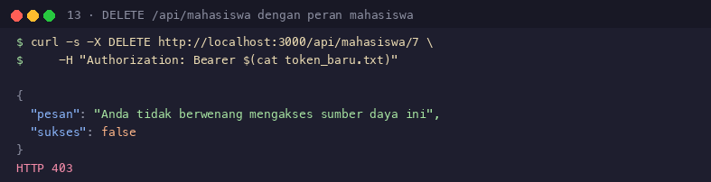

# TUGAS 8 VALIDASI, JWT, DAN PENANGANAN GALAT TERSTRUKTUR PADA FIBER

**PRAKTIKUM PEMROGRAMAN WEB II**

Muhammad Faiz Mubarok/H1H024051/B ke B

## Tugas Praktikum

### 1. Konfigurasi JWT

Konfigurasi JWT ditambahkan pada `.env` dan struct `Konfigurasi` di `internal/config/config.go`. Nilai `JWT_TTL_MENIT` dibaca dengan `strconv.Atoi` dan dikembalikan ke 120 bila bukan angka.

```env
JWT_SECRET=ubah-nilai-ini-menjadi-acak-dan-panjang
JWT_TTL_MENIT=120
```

```go
type Konfigurasi struct {
	NamaAplikasi string
	Port         string
	Lingkungan   string
	DbHost       string
	DbPort       string
	DbNama       string
	DbUser       string
	DbSandi      string
	JwtSecret    string
	JwtTtlMenit  int
}
```

### 2. Model Pengguna

Model `Pengguna` didefinisikan di `internal/model/pengguna.go`. Kolom kata sandi diberi tag `json:"-"` sehingga tidak pernah ikut terkirim pada respons JSON, dan kolom email diberi `uniqueIndex`.

```go
type Pengguna struct {
	ID        uint      `gorm:"primaryKey" json:"id"`
	Nama      string    `gorm:"size:100" json:"nama"`
	Email     string    `gorm:"size:100;uniqueIndex" json:"email"`
	KataSandi string    `gorm:"size:255" json:"-"`
	Peran     string    `gorm:"size:20;default:mahasiswa" json:"peran"`
	CreatedAt time.Time `json:"dibuat_pada"`
	UpdatedAt time.Time `json:"diubah_pada"`
}
```

Model tersebut ditambahkan pada `AutoMigrate` di `internal/config/migrasi.go` bersama model `TokenDaftarHitam` untuk tugas nomor 3.

### 3. Validator dan pesan galat

Paket `internal/validasi/validasi.go` membungkus `go-playground/validator/v10`. Fungsi `Periksa` mengembalikan daftar `PesanGalat` berisi nama field dan pesan berbahasa Indonesia yang disusun fungsi `susunPesan` berdasarkan tag pelanggaran.

```go
var pemeriksa = validator.New()

type PesanGalat struct {
	Field string `json:"field"`
	Pesan string `json:"pesan"`
}

func Periksa(data any) []PesanGalat {
	err := pemeriksa.Struct(data)
	if err == nil {
		return nil
	}
	daftar := []PesanGalat{}
	for _, item := range err.(validator.ValidationErrors) {
		daftar = append(daftar, PesanGalat{
			Field: item.Field(),
			Pesan: susunPesan(item),
		})
	}
	return daftar
}
```

### 4. Aturan validasi pada DTO dan handler

Aturan validasi ditulis pada tag struct di `internal/handler/dto.go` untuk `PermintaanMahasiswa`, `PermintaanRegistrasi`, dan `PermintaanLogin`.

```go
type PermintaanMahasiswa struct {
	ProgramStudiID uint    `json:"program_studi_id" validate:"required,gte=1"`
	Nim            string  `json:"nim" validate:"required,min=5,max=20,nim"`
	Nama           string  `json:"nama" validate:"required,min=3,max=100"`
	Email          string  `json:"email" validate:"required,email,max=100"`
	Angkatan       int     `json:"angkatan" validate:"required,gte=2000,lte=2100"`
	Ipk            float64 `json:"ipk" validate:"gte=0,lte=4"`
	Aktif          *bool   `json:"aktif"`
}
```

Handler `BuatMahasiswa` di `internal/handler/mahasiswa_handler.go` memanggil `validasi.Periksa` setelah binding body. Bila tidak valid, respons `422` memuat daftar galat per field dengan format yang sama seperti respons galat lainnya.

```go
galat := validasi.Periksa(permintaan)
if galat != nil {
	return c.Status(fiber.StatusUnprocessableEntity).JSON(fiber.Map{
		"sukses": false,
		"pesan":  "Data yang dikirim tidak valid",
		"galat":  galat,
	})
}
```

### 5. Utilitas token JWT

`internal/auth/token.go` memuat `TerbitkanToken` dan `PeriksaToken`. Token ditandatangani dengan HS256, klaimnya memuat `sub`, `iat`, `exp`, `iss`, dan `jti` (penanda unik untuk pencabutan pada tugas nomor 3). `PeriksaToken` menolak token yang metode penandatanganannya bukan HMAC.

```go
type Klaim struct {
	Peran string `json:"peran"`
	jwt.RegisteredClaims
}

func TerbitkanToken(idPengguna uint, peran string, rahasia string, ttlMenit int) (string, error) {
	sekarang := time.Now()

	jti, err := jtiBaru()
	if err != nil {
		return "", err
	}

	klaim := Klaim{
		Peran: peran,
		RegisteredClaims: jwt.RegisteredClaims{
			ID:        jti,
			Subject:   strconv.FormatUint(uint64(idPengguna), 10),
			IssuedAt:  jwt.NewNumericDate(sekarang),
			ExpiresAt: jwt.NewNumericDate(sekarang.Add(time.Duration(ttlMenit) * time.Minute)),
			Issuer:    "pemweb2-fiber-api",
		},
	}

	token := jwt.NewWithClaims(jwt.SigningMethodHS256, klaim)

	return token.SignedString([]byte(rahasia))
}
```

### 6. Handler autentikasi

`internal/handler/auth_handler.go` memuat `Registrasi`, `Login`, dan `Profil`. Kata sandi di-hash dengan bcrypt sebelum disimpan, dan pemeriksaan login memakai `bcrypt.CompareHashAndPassword`.

```go
hash, err := bcrypt.GenerateFromPassword([]byte(permintaan.KataSandi), bcrypt.DefaultCost)
if err != nil {
	return fiber.NewError(fiber.StatusInternalServerError, "Gagal memproses kata sandi")
}

pengguna := model.Pengguna{
	Nama:      permintaan.Nama,
	Email:     permintaan.Email,
	KataSandi: string(hash),
	Peran:     "mahasiswa",
}
```

Pesan untuk email tidak ditemukan dan kata sandi salah dibuat sama, yaitu "Email atau kata sandi tidak sesuai".

### 7. Middleware autentikasi dan otorisasi peran

`internal/middleware/autentikasi.go` memuat `Autentikasi` dan `HanyaPeran`. Middleware `Autentikasi` memeriksa header `Authorization` berformat `Bearer <token>`, memverifikasi token, lalu menanam `id_pengguna` dan `peran` pada `c.Locals`.

```go
klaim, err := auth.PeriksaToken(bagian[1], konf.JwtSecret)
if err != nil {
	return fiber.NewError(fiber.StatusUnauthorized, "Token tidak valid atau sudah kedaluwarsa")
}

id, err := strconv.ParseUint(klaim.Subject, 10, 64)
if err != nil {
	return fiber.NewError(fiber.StatusUnauthorized, "Isi token tidak sesuai")
}

c.Locals("id_pengguna", uint(id))
c.Locals("peran", klaim.Peran)
```

Middleware `HanyaPeran` menerima daftar peran yang diizinkan dan mengembalikan galat `403` bila peran pengguna tidak termasuk.

### 8. Melindungi rute

`internal/router/router.go` memisahkan rute publik (`registrasi`, `login`) dari rute terlindungi. Rute tulis hanya untuk peran admin dan dosen, rute hapus hanya admin.

```go
terlindungi := api.Group("", middleware.Autentikasi())

terlindungi.Get("/auth/profil", handler.Profil)
terlindungi.Post("/auth/logout", handler.Logout)
terlindungi.Post("/auth/segarkan", handler.Segarkan)

mahasiswa := terlindungi.Group("/mahasiswa")

mahasiswa.Get("/", handler.DaftarMahasiswa)
mahasiswa.Get("/:id", handler.DetailMahasiswa)

mahasiswa.Post("/", middleware.HanyaPeran("admin", "dosen"), handler.BuatMahasiswa)
mahasiswa.Put("/:id", middleware.HanyaPeran("admin", "dosen"), handler.PerbaruiMahasiswa)
mahasiswa.Delete("/:id", middleware.HanyaPeran("admin"), handler.HapusMahasiswa)
```

Pada Fiber, handler dieksekusi berurutan sehingga middleware peran harus diletakkan sebelum handler. Snippet modul menuliskannya sebaliknya (`handler.BuatMahasiswa` sebelum `HanyaPeran`); saat pengujian, pengguna berperan mahasiswa bisa membuat data karena `BuatMahasiswa` mengembalikan respons tanpa memanggil `c.Next()` sehingga `HanyaPeran` tidak pernah tereksekusi. Urutan pada implementasi ini sudah dibalik agar pemeriksaan peran berjalan lebih dulu.

### 9. Penangan galat terstruktur

`penanganGalat` di `cmd/api/main.go` selalu mengembalikan kunci `sukses` dan `pesan` pada semua respons galat. Pesan teknis hanya dicatat ke log server bila statusnya `500`, sedangkan klien menerima pesan umum agar informasi internal tidak bocor.

```go
if kode == fiber.StatusInternalServerError {
	log.Println("Galat internal:", err.Error())
}
return c.Status(kode).JSON(fiber.Map{
	"sukses": false,
	"pesan":  pesan,
})
```

### 10. Endpoint POST /api/auth/segarkan

Rute `segarkan` berada pada grup terlindungi sehingga hanya bisa diakses dengan token yang masih berlaku. Identitas dan peran diambil dari `c.Locals` yang ditanam middleware autentikasi, lalu token baru diterbitkan dengan `auth.TerbitkanToken`.

```go
func Segarkan(c fiber.Ctx) error {
	idPengguna, cocokId := c.Locals("id_pengguna").(uint)
	peran, cocokPeran := c.Locals("peran").(string)

	if cocokId == false || cocokPeran == false {
		return fiber.NewError(fiber.StatusUnauthorized, "Konteks autentikasi tidak ditemukan")
	}

	konf := config.Muat()

	token, err := auth.TerbitkanToken(idPengguna, peran, konf.JwtSecret, konf.JwtTtlMenit)
	if err != nil {
		return fiber.NewError(fiber.StatusInternalServerError, "Gagal menerbitkan token")
	}

	return c.JSON(fiber.Map{
		"sukses": true,
		"pesan":  "Token berhasil diperbarui",
		"data": fiber.Map{
			"token": token,
			"tipe":  "Bearer",
			"terbit_pada": time.Now().Format(time.RFC3339),
		},
	})
}
```

### 11. Aturan validasi kustom NIM

Aturan kustom didaftarkan pada `init()` paket `validasi` dengan nama tag `nim`. Pola yang dipakai adalah `^H[0-9]+` (diawali huruf H lalu minimal satu angka). Pola `^H[0-9]+$` sengaja tidak dipakai karena akan menolak NIM UNSOED asli seperti `H1H024051` yang memuat huruf H kedua di tengah.

```go
var polaNim = regexp.MustCompile(`^H[0-9]+`)

func init() {
	pemeriksa.RegisterValidation("nim", func(fl validator.FieldLevel) bool {
		return polaNim.MatchString(fl.Field().String())
	})
}
```

Aturan dipasang pada field `Nim` DTO, dan `susunPesan` menambahkan kasus `nim` dengan pesan "NIM harus diawali huruf H diikuti angka".

```go
Nim string `json:"nim" validate:"required,min=5,max=20,nim"`
```

### 12. Tabel daftar hitam token untuk logout

JWT tidak menyimpan status di server sehingga logout perlu usaha tambahan. Setiap token diberi klaim `jti` berupa ID acak 16 byte, lalu logout mencatat `jti` tersebut ke tabel `TokenDaftarHitam` di `internal/model/token_daftar_hitam.go`.

```go
type TokenDaftarHitam struct {
	ID         uint      `gorm:"primaryKey" json:"id"`
	Jti        string    `gorm:"size:64;uniqueIndex" json:"jti"`
	Kadaluarsa time.Time `json:"kadaluarsa"`
	CreatedAt  time.Time `json:"dibuat_pada"`
}
```

Middleware `Autentikasi` memeriksa `jti` token pada tabel tersebut setiap request dan menolak token yang sudah terdaftar.

```go
if klaim.ID != "" {
	var jumlah int64
	config.DB.Model(&model.TokenDaftarHitam{}).Where("jti = ?", klaim.ID).Count(&jumlah)
	if jumlah > 0 {
		return fiber.NewError(fiber.StatusUnauthorized, "Token telah dicabut, silakan login kembali")
	}
}
```

Handler `Logout` memasukkan `jti` token aktif beserta waktu kedaluwarsanya. Kolom `kadaluarsa` memungkinkan entri yang sudah kedaluwarsa dibersihkan berkala tanpa memengaruhi token lain.

### 13. Analisis perbandingan autentikasi Modul 5 (Laravel Sanctum) dan Modul 8 (Fiber + JWT)

Implementasi Modul 5 pada proyek `latihan-laravel` memakai Laravel Sanctum; implementasi Modul 8 pada proyek `latihan-fiber` memakai JWT buatan sendiri. Perbandingan diukur dari kode yang ditulis untuk fitur yang setara: registrasi, login, profil, logout, dan proteksi peran.

| Aspek | Modul 5 — Laravel Sanctum | Modul 8 — Fiber + JWT |
|---|---|---|
| Jumlah kode inti | ± 184 baris (`AuthController.php` 149 + `routes/api.php` 35) | ± 432 baris (`auth_handler.go` 182, `token.go` 74, `autentikasi.go` 72, `validasi.go` 65, `router.go` 39) |
| Penerbitan token | Satu baris: `$user->createToken('api')->plainTextToken` | Dibuat sendiri: struktur klaim, penandatanganan HS256, `strconv` untuk `sub`, ± 40 baris |
| Verifikasi token | Middleware bawaan `auth:sanctum`, verifikasi lewat basis data | Middleware sendiri: memecah header, `jwt.ParseWithClaims`, cek metode HMAC, cek daftar hitam |
| Validasi masukan | Bawaan: `$request->validate([...])` dengan pesan otomatis | Pustaka pihak ketiga `validator/v10` + penerjemah pesan sendiri |
| Otorisasi peran | `ability:mahasiswa:tulis` bawaan Sanctum + middleware `peran.admin` buatan | Middleware `HanyaPeran("admin","dosen")` buatan sendiri |
| Hash kata sandi | Bawaan `Hash::make()` / `Hash::check()` | `golang.org/x/crypto/bcrypt` dipasang manual |
| Pencabutan token | Hapus baris di tabel `personal_access_tokens`; `logout-semua` sederhana | Perlu tabel daftar hitam sendiri + pemeriksaan di setiap request |
| Kecepatan verifikasi | Perlu akses basis data setiap request | Cukup cek tanda tangan, tanpa basis data (kecuali daftar hitam aktif) |
| Fleksibilitas | Terikat ekosistem Laravel dan satu basis data | Token dapat diverifikasi layanan mana pun yang memegang `JWT_SECRET` |

Dari sisi jumlah kode dan kemudahan, Sanctum jauh lebih ringkas karena penerbitan, verifikasi, pencabutan, dan ability sudah disediakan kerangka kerja; pengembang hanya menulis controller dan rute. Pada Fiber semua lapisan itu dibangun sendiri sehingga kodenya sekitar dua sampai tiga kali lipat, tetapi cara kerja JWT menjadi terlihat eksplisit. Dari sisi fleksibilitas, JWT unggul pada arsitektur terdistribusi karena token dapat diperiksa layanan lain tanpa berbagi basis data, sedangkan Sanctum mensyaratkan semua layanan mengakses tabel token yang sama. Sebaliknya untuk pencabutan segera, Sanctum lebih mudah karena cukup menghapus satu baris, sementara JWT membutuhkan tambahan daftar hitam yang membuat verifikasi kembali memerlukan basis data. Kesimpulannya, Sanctum cocok untuk aplikasi monolit yang butuh cepat jadi dan pencabutan mudah, sedangkan JWT cocok untuk API terdistribusi yang menuntut verifikasi cepat dan independen dari basis data.

## Hasil Pengujian

Screenshot berikut diambil dari pengujian langsung terhadap API. Pengujian memakai dua pengguna: `sinta@example.com` (peran mahasiswa, hasil registrasi) dan `fajar@example.com` (peran admin, diperbarui melalui basis data).

Gambar 1. POST `/api/auth/registrasi` pengguna baru Sinta Ayu (201)


Gambar 2. POST `/api/auth/login` kredensial benar (200)


Gambar 3. POST `/api/auth/login` kata sandi salah (401)



Gambar 4. GET `/api/auth/profil` dengan token (200)



Gambar 5. GET `/api/auth/profil` tanpa token (401)



Gambar 6. POST `/api/mahasiswa` body tidak lengkap (422)



Gambar 7. POST `/api/mahasiswa` NIM `A1H024099` (422)



Gambar 8. POST `/api/mahasiswa` dengan token peran mahasiswa (403)



Gambar 9. POST `/api/mahasiswa` dengan token peran admin (201)


Gambar 10. POST `/api/auth/segarkan` dengan token sah (200)


Gambar 11. POST `/api/auth/logout` (200)


Gambar 12. GET `/api/auth/profil` memakai token yang telah di-logout (401)


Gambar 13. DELETE `/api/mahasiswa/6` dengan token peran mahasiswa (403)



Gambar 14. DELETE `/api/mahasiswa/6` dengan token peran admin (200)


Gambar 15. Isi payload token diuraikan dengan `base64 -d`


| Uji | Permintaan | Status | Hasil |
|-----|-----------|--------|-------|
| Registrasi | POST /api/auth/registrasi | 201 | Sinta Ayu terdaftar |
| Login | POST /api/auth/login kredensial benar | 200 | token Bearer diterbitkan |
| Login gagal | POST /api/auth/login kata sandi salah | 401 | pesan umum, tidak menyebut bagian yang salah |
| Profil | GET /api/auth/profil + token | 200 | data pengguna |
| Tanpa token | GET /api/auth/profil | 401 | Header Authorization tidak ditemukan |
| Validasi body | POST /api/mahasiswa body tidak lengkap | 422 | daftar galat per field |
| Validasi NIM | POST /api/mahasiswa nim `A1H024099` | 422 | aturan kustom `nim` |
| Akses mahasiswa | POST /api/mahasiswa + token mahasiswa | 403 | tidak berwenang |
| Akses admin | POST /api/mahasiswa + token admin | 201 | data tersimpan |
| Segarkan | POST /api/auth/segarkan + token sah | 200 | token baru diterbitkan |
| Logout | POST /api/auth/logout | 200 | jti masuk daftar hitam |
| Token dicabut | GET /api/auth/profil + token lama | 401 | Token telah dicabut |
| Hapus mahasiswa | DELETE /api/mahasiswa/6 + token mahasiswa | 403 | tidak berwenang |
| Hapus admin | DELETE /api/mahasiswa/6 + token admin | 200 | data terhapus |
| Isi token | `base64 -d` bagian payload | - | klaim `peran`, `iss`, `sub`, `exp`, `iat`, `jti` terbaca |

Uraian payload pada Gambar 15 memperlihatkan bahwa isi token hanya dikodekan Base64Url, bukan dienkripsi.

```json
{"peran":"admin","iss":"pemweb2-fiber-api","sub":"1","exp":1794841560,"iat":1794834360,
"jti":"19be74fc9a3cf017178357c66c439c38"}
```

## Pertanyaan Pembahasan

1. Mengapa bcrypt lebih sesuai untuk kata sandi dibandingkan fungsi hash cepat seperti SHA-256?

   SHA-256 dirancang untuk memproses data secepat mungkin, jutaan hash per detik pada GPU, sehingga serangan brute force terhadap kata sandi yang di-hash SHA-256 sangat murah. bcrypt justru sengaja dibuat lambat: iterasinya diulang sebanyak `cost` (12 pada `bcrypt.DefaultCost` berarti 2^12 putaran) dan pemakaiannya sulit dipercepat dengan GPU. bcrypt juga otomatis menyisipkan salt acak ke dalam hash sehingga dua pengguna dengan kata sandi sama menghasilkan hash berbeda dan serangan tabel (rainbow table) tidak berguna. Untuk kata sandi yang dipilih manusia, fungsi yang lambat dan bernahas seperti bcrypt jauh lebih aman daripada fungsi hash cepat.

2. Apa konsekuensi apabila nilai JWT_SECRET bocor?

   Siapa pun yang memegang `JWT_SECRET` dapat menandatangani token palsu kapan saja: ia bisa membuat token dengan `sub` milik pengguna mana pun (misalnya admin) dan `peran` sesuka hati, lalu semua server menerimanya sebagai sah karena tanda tangannya valid. Ia juga dapat mengubah klaim token yang sah, misalnya menaikkan `exp` agar tidak kedaluwarsa atau mengubah `peran` menjadi admin, lalu menandatanganinya ulang. Karena JWT tidak menyimpan status di server, tidak ada cara membedakan token buatan penyerang dari token asli kecuali kunci diganti. Konsekuensinya kebocoran total sistem: satu-satunya penanganan adalah mengganti kunci yang otomatis membatalkan seluruh token pengguna yang sah, lalu mengaudit penyalahgunaan yang sudah terjadi. Karena itu kunci harus panjang, acak, tidak pernah masuk repositori (diletakkan pada `.env` yang diabaikan git), dan hanya dibagikan ke layanan yang benar-benar membutuhkan.

3. Mengapa penerapan logout pada JWT memerlukan usaha tambahan dibandingkan token tersimpan?

   Pada token tersimpan (Sanctum), token hanyalah baris di tabel `personal_access_tokens`, sehingga logout cukup menghapus baris itu dan request berikutnya otomatis gagal. Pada JWT tidak ada status di server: token yang sah tetap sah sampai `exp`-nya lewat, dan itu justru keunggulannya, yaitu verifikasi tanpa basis data. Untuk mencabut token sebelum kedaluwarsa, server harus mulai menyimpan keadaan lagi, persis hal yang coba dihindari JWT. Cara umumnya adalah daftar hitam: logout memasukkan penanda token (klaim `jti`) ke tabel, dan middleware memeriksa tabel itu setiap request. Usaha tambahannya nyata: tabel baru, pemeriksaan basis data tambahan per request, dan pembersihan entri yang sudah kedaluwarsa agar tabel tidak membengkak. Inilah trade-off yang diterapkan pada tugas nomor 3.

4. Jelaskan alasan pesan login gagal sebaiknya tidak menyebutkan apakah email atau kata sandi yang salah.

   Jika server memberi tahu bagian mana yang salah, penyerang dapat memanfaatkannya untuk mengumpulkan data: pesan "email tidak ditemukan" berbeda dengan "kata sandi salah" disebut user enumeration, yaitu penyerang mencoba daftar email dan dari perbedaan pesan mengetahui email mana yang terdaftar di sistem. Setelah itu penyerang cukup mencoba kata sandi pada akun yang sudah pasti ada. Dengan pesan umum "Email atau kata sandi tidak sesuai" untuk kedua kasus, setiap kegagalan terlihat identik sehingga penyerang tidak memperoleh informasi apa pun dari perbedaan respons. Praktik ini diterapkan pada implementasi: `Login` memakai satu pesan yang sama untuk kedua kasus, dan waktu respons sebaiknya juga diseragamkan agar tidak bocor lewat perbedaan kecepatan respons.
