# TUGAS 9 INTEGRASI BACKEND DAN FRONTEND DENGAN REACT, VITE, DAN AXIOS

**PRAKTIKUM PEMROGRAMAN WEB II**

Muhammad Faiz Mubarok/H1H024051/B ke B

## Tugas Praktikum

### 1. Konfigurasi CORS pada Laravel

Berkas konfigurasi CORS diterbitkan dengan `php artisan config:publish cors`, lalu `config/cors.php` disesuaikan agar hanya origin frontend pengembangan yang boleh membaca respons API.

```php
'paths' => ['api/*'],
'allowed_methods' => ['*'],
'allowed_origins' => ['http://localhost:5173'],
'allowed_headers' => ['*'],
'exposed_headers' => [],
'max_age' => 0,
'supports_credentials' => false,
```

Nilai `paths` dibatasi pada `api/*` supaya berkas statis dan halaman web Laravel tidak ikut memakai kebijakan itu. Origin ditulis lengkap beserta skema dan port karena `http://localhost:5173` dan `http://localhost:8000` adalah dua origin berbeda. Setelah perubahan, cache konfigurasi dibersihkan dengan `php artisan config:clear` agar nilai baru langsung dipakai.

```bash
php artisan config:publish cors
php artisan config:clear
```

### 2. Konfigurasi CORS pada Fiber

Middleware CORS dipasang pada `cmd/api/main.go` sebelum router didaftarkan. Pemasangan harus lebih dulu dari `router.Daftarkan` agar permintaan `OPTIONS` dijawab middleware sebelum mencapai handler.

```go
app.Use(cors.New(cors.Config{
	AllowOrigins: []string{"http://localhost:5173"},
	AllowMethods: []string{"GET", "POST", "PUT", "PATCH", "DELETE", "OPTIONS"},
	AllowHeaders: []string{"Origin", "Content-Type", "Accept", "Authorization"},
}))
```

```go
import "github.com/gofiber/fiber/v3/middleware/cors"
```

Daftar `AllowHeaders` memuat `Authorization` karena frontend mengirim token Bearer pada setiap permintaan terlindungi. Header itu juga yang memicu preflight pada permintaan `GET`, sebab permintaan dengan header kustom tidak lagi dianggap sederhana oleh peramban. Penggunaan `AllowOrigins` bernilai `*` bersama kredensial tidak dipakai karena dilarang spesifikasi CORS; proyek ini memakai token pada header, bukan cookie, sehingga `supports_credentials` tetap `false` di Laravel dan kredensial tidak diaktifkan di Fiber.

### 3. Membuat proyek frontend React dengan Vite

Proyek dibuat di dalam folder induk pemweb2 agar seluruh bagian tugas berada pada satu repositori.

```bash
npm create vite@latest frontend-pemweb2 -- --template react
cd frontend-pemweb2
npm install
npm install axios react-router-dom
npm run dev
```

Hasil yang terpasang adalah React 19.3, Vite 8.3, Axios 1.21, dan React Router 7.18. Struktur halaman dipisahkan menjadi `src/api` untuk lapisan jaringan, `src/halaman` untuk halaman, dan `src/komponen` untuk komponen bersama.

```text
frontend-pemweb2/
├── .env
├── src/
│   ├── api/
│   │   ├── konfigurasi.js
│   │   ├── klien.js
│   │   ├── layananAuth.js
│   │   ├── layananMahasiswa.js
│   │   └── penyesuai.js
│   ├── komponen/
│   │   └── RuteTerlindungi.jsx
│   ├── halaman/
│   │   ├── DaftarMahasiswa.jsx
│   │   └── Login.jsx
│   ├── App.jsx
│   └── index.css
└── package.json
```

### 4. Variabel lingkungan dan satu pengaturan backend

Berkas `.env` memuat alamat kedua backend dan satu variabel `VITE_API_TARGET` sebagai penentu backend aktif. Hanya variabel berawalan `VITE_` yang diteruskan ke bundel, sehingga berkas ini tidak boleh memuat rahasia seperti `JWT_SECRET` atau kata sandi basis data.

```env
VITE_API_TARGET=fiber
VITE_API_LARAVEL=http://127.0.0.1:8000/api
VITE_API_FIBER=http://localhost:3000/api
```

`src/api/konfigurasi.js` membaca variabel tersebut, memvalidasi pilihannya, lalu mengekspor `baseURL` dan `backendAktif`.

```js
const target = (import.meta.env.VITE_API_TARGET || 'laravel').toLowerCase()

const alamat = {
  laravel: import.meta.env.VITE_API_LARAVEL,
  fiber: import.meta.env.VITE_API_FIBER,
}

if (!alamat[target]) {
  throw new Error(
    `VITE_API_TARGET bernilai "${target}", padahal pilihan yang tersedia hanya laravel atau fiber.`,
  )
}

export const backendAktif = target
export const baseURL = alamat[target]
```

Dengan cara ini perpindahan backend cukup dilakukan dengan mengubah satu baris pada `.env` menjadi `laravel` atau `fiber`, lalu menjalankan ulang server pengembangan. Tidak ada alamat yang ditulis langsung di dalam komponen.

### 5. Klien HTTP Axios dan interceptor

`src/api/klien.js` membuat satu instance Axios yang dipakai seluruh layanan. Interceptor permintaan menyisipkan token dari `sessionStorage`, sedangkan interceptor respons menangani status `401` secara terpusat.

```js
const klien = axios.create({
  baseURL: baseURL,
  headers: {
    Accept: 'application/json',
    'Content-Type': 'application/json',
  },
  timeout: 10000,
})

klien.interceptors.request.use((konfigurasi) => {
  const token = sessionStorage.getItem('token')

  if (token) {
    konfigurasi.headers.Authorization = `Bearer ${token}`
  }

  return konfigurasi
})
```

```js
klien.interceptors.response.use(
  (respons) => respons,
  (galat) => {
    const url = (galat.config && galat.config.url) || ''
    const sedangLogin = url.includes('/auth/login')
    const sudahDiHalamanLogin = window.location.pathname === '/login'

    if (galat.response && galat.response.status === 401 && !sedangLogin && !sudahDiHalamanLogin) {
      sessionStorage.removeItem('token')
      sessionStorage.removeItem('pengguna')
      window.location.href = '/login'
    }

    return Promise.reject(galat)
  },
)
```

Snippet modul langsung mengalihkan ke `/login` pada setiap `401`. Pola itu juga menangkap kegagalan login, sehingga pesan "Email atau kata sandi tidak sesuai" hilang karena halaman dimuat ulang. Implementasi ini menambahkan pengecualian untuk permintaan login dan untuk halaman login yang sedang dibuka, sementara token kedaluwarsa pada permintaan lain tetap ditangani terpusat.

### 6. Lapisan penyesuai kontrak backend

Kedua backend memakai nama field dan bentuk meta yang berbeda. `src/api/penyesuai.js` menjadi satu-satunya tempat perbedaan itu diterjemahkan. Lapisan ini mengekspor objek `penyesuai` sesuai `backendAktif`, sehingga halaman dan layanan selalu bekerja dengan bentuk data yang seragam.

```js
const laravel = {
  parameterDaftar({ halaman, cari, perHalaman }) {
    return { page: halaman, cari: cari, per_halaman: perHalaman }
  },

  normalkanDaftar(data) {
    const meta = data.meta || {}

    return {
      daftar: data.data || [],
      meta: {
        halaman: meta.current_page || 1,
        totalHalaman: meta.last_page || 1,
        total: meta.total || 0,
      },
    }
  },

  payloadLogin(email, kataSandi) {
    return { email: email, password: kataSandi }
  },
}
```

```js
const fiber = {
  parameterDaftar({ halaman, cari, perHalaman }) {
    return { halaman: halaman, cari: cari, per_halaman: perHalaman }
  },

  normalkanDaftar(data) {
    const meta = data.meta || {}

    return {
      daftar: data.data || [],
      meta: {
        halaman: meta.halaman || 1,
        totalHalaman: meta.total_halaman || 1,
        total: meta.total || 0,
      },
    }
  },

  payloadLogin(email, kataSandi) {
    return { email: email, kata_sandi: kataSandi }
  },
}
```

Perbedaan yang diserap lapisan ini adalah parameter halaman (`page` dan `halaman`), nama field login (`password` dan `kata_sandi`), kunci meta (`current_page`/`last_page` dan `halaman`/`total_halaman`), serta bentuk galat validasi. Galat Laravel berbentuk objek `galat` berisi larik pesan per field, sedangkan Fiber mengirim larik objek `{field, pesan}` dengan nama field struct Go seperti `ProgramStudiID`. Keduanya dinormalkan menjadi `{pesan, galatField}` dengan kunci field huruf kecil.

```js
const namaFieldFiber = {
  ProgramStudiID: 'program_studi_id',
  Nim: 'nim',
  Nama: 'nama',
  Email: 'email',
  Angkatan: 'angkatan',
  Ipk: 'ipk',
  Aktif: 'aktif',
}

export const penyesuai = backendAktif === 'fiber' ? fiber : laravel
```

### 7. Layanan data autentikasi dan mahasiswa

`src/api/layananAuth.js` membungkus tiga operasi autentikasi. Payload login diserahkan kepada penyesuai sehingga halaman login tidak perlu tahu field mana yang dipakai backend.

```js
export async function login(email, kataSandi) {
  const respons = await klien.post(
    '/auth/login',
    penyesuai.payloadLogin(email, kataSandi),
  )

  return penyesuai.normalkanLogin(respons.data)
}
```

`src/api/layananMahasiswa.js` memuat operasi daftar, detail, simpan, dan hapus. Parameter daftar dan bentuk respons juga dilewatkan penyesuai.

```js
export async function ambilDaftarMahasiswa(parameter) {
  const respons = await klien.get(
    '/mahasiswa',
    { params: penyesuai.parameterDaftar(parameter) },
  )

  return penyesuai.normalkanDaftar(respons.data)
}

export async function simpanMahasiswa(data) {
  const respons = await klien.post('/mahasiswa', data)

  return respons.data
}

export async function hapusMahasiswa(id) {
  const respons = await klien.delete(`/mahasiswa/${id}`)

  return respons.data
}
```

### 8. Halaman login

`src/halaman/Login.jsx` memakai dua state untuk isian, satu state pesan galat, dan satu state status memuat. Setelah login berhasil, token dan data pengguna disimpan pada `sessionStorage`, lalu navigasi diarahkan ke `/mahasiswa`.

```jsx
try {
  const hasil = await login(email, kataSandi)

  sessionStorage.setItem('token', hasil.token)
  sessionStorage.setItem('pengguna', JSON.stringify(hasil.pengguna))
  navigasi('/mahasiswa')
} catch (galat) {
  setPesanGalat(uraikanGalat(galat).pesan)
} finally {
  setSedangMemuat(false)
}
```

Tombol berubah menjadi teks "Memproses..." dan dinonaktifkan selama permintaan berlangsung. Pesan galat dari server ditampilkan apa adanya, termasuk ketika backend tidak dapat dihubungi.

### 9. Routing dan rute terlindungi

`src/komponen/RuteTerlindungi.jsx` memeriksa keberadaan token sebelum merender halaman. Bila token tidak ada, pengguna dialihkan ke halaman login dengan `replace` agar halaman terlindungi tidak tersimpan pada riwayat peramban.

```jsx
export default function RuteTerlindungi({ children }) {
  const token = sessionStorage.getItem('token')

  if (!token) {
    return <Navigate to="/login" replace />
  }

  return children
}
```

`src/App.jsx` mendaftarkan tiga rute: pengalihan akar ke `/mahasiswa`, halaman `/login`, dan halaman `/mahasiswa` yang dibungkus `RuteTerlindungi`. Rute yang tidak dikenal juga diarahkan ke daftar mahasiswa.

### 10. Halaman daftar mahasiswa

`src/halaman/DaftarMahasiswa.jsx` memuat data melalui `useEffect` yang bergantung pada halaman, kata pencarian, dan penghitung penyegaran. Pemuatan ditunda 400 milidetik setelah ketikan terakhir agar satu kata tidak menghasilkan satu permintaan per huruf.

```jsx
const penunda = setTimeout(muatData, 400)

return () => {
  dibatalkan = true
  clearTimeout(penunda)
}
```

Flag `dibatalkan` mencegah respons lama menimpa state setelah pengguna mengetik lagi. Halaman menampilkan tiga keadaan yang berbeda: teks "Memuat data..." saat permintaan berjalan, pesan galat bila permintaan gagal, dan keadaan kosong bila hasil pencarian memang tidak ada. Pemisahan itu penting agar pengguna tidak menyimpulkan data hilang ketika sebenarnya server bermasalah.

Pagination memakai `meta.halaman` dan `meta.totalHalaman` hasil normalisasi, bukan nama field salah satu backend. Tombol sebelumnya dan berikutnya dinonaktifkan pada batas halaman serta selama pemuatan.

### 11. Formulir tambah mahasiswa dan pesan galat validasi

Formulir tambah ditampilkan di atas tabel ketika tombol "+ Tambah mahasiswa" ditekan. Formulir memakai `noValidate` agar pemeriksaan dilakukan server, sebab aturan sesungguhnya berada di backend dan berbeda antara Laravel dan Fiber. Setiap kegagalan validasi ditampilkan tepat di bawah kolom yang bersangkutan.

```jsx
<form className="form-mahasiswa" onSubmit={tanganiTambah} noValidate>
  <div className="kolom-form">
    <label htmlFor="nim">NIM</label>
    <input
      id="nim"
      value={form.nim}
      onChange={(peristiwa) => ubahForm('nim', peristiwa.target.value)}
    />
    {galatForm.nim && <small className="galat-field">{galatForm.nim}</small>}
  </div>
```

Handler pengiriman mengirim angka sebagai `Number` dan meneruskan hasil normalisasi galat ke state.

```jsx
try {
  await simpanMahasiswa({
    nim: form.nim,
    nama: form.nama,
    email: form.email,
    angkatan: Number(form.angkatan),
    ipk: Number(form.ipk || 0),
    program_studi_id: Number(form.program_studi_id),
    aktif: form.aktif,
  })

  tutupForm()
  setHalaman(1)
  setVersi((nilai) => nilai + 1)
} catch (galat) {
  const hasil = uraikanGalat(galat)
  setGalatForm(hasil.galatField)
  setPesanForm(hasil.pesan)
}
```

Setelah berhasil, formulir ditutup dan dikosongkan, halaman kembali ke satu, dan daftar dimuat ulang. Setelah gagal, isian tidak dihapus agar pengguna dapat memperbaiki kolom yang ditandai.

### 12. Tombol hapus dengan dialog konfirmasi

Setiap baris memiliki tombol Hapus yang tidak langsung mengirim permintaan. Tombol hanya menyimpan baris sasaran pada state `targetHapus`, lalu dialog konfirmasi ditampilkan.

```jsx
<button
  type="button"
  className="tombol-hapus"
  onClick={() => setTargetHapus(mahasiswa)}
>
  Hapus
</button>
```

Dialog menampilkan nama dan NIM agar pengguna dapat memastikan baris yang dipilih. Penghapusan baru dijalankan setelah tombol "Ya, hapus" ditekan.

```jsx
await hapusMahasiswa(targetHapus.id)
setTargetHapus(null)

if (daftar.length === 1 && halaman > 1) {
  setHalaman(halaman - 1)
} else {
  setVersi((nilai) => nilai + 1)
}
```

Bila baris yang dihapus adalah satu-satunya data pada halaman terakhir, halaman mundur satu langkah agar tidak menampilkan halaman kosong. Selain itu daftar dimuat ulang dengan menaikkan `versi`, sehingga tabel langsung mencerminkan keadaan server tanpa muat ulang peramban. Kegagalan penghapusan, misalnya karena token tidak berwenang, ditampilkan pada kotak galat di atas tabel.

### 13. Pengamatan lalu lintas jaringan dan galat CORS

Server Laravel dijalankan pada port 8000, Fiber pada port 3000, dan frontend pada port 5173. Pada tab Network terlihat permintaan `OPTIONS` mendahului `POST` dan `DELETE` karena keduanya membawa header `Authorization` dan `Content-Type`. Permintaan `OPTIONS` tidak memuat `Authorization` karena tujuannya hanya menanyakan izin. Respons preflight memuat `Access-Control-Allow-Origin: http://localhost:5173`, sedangkan permintaan utama memuat `Authorization: Bearer ...`.

Sebagai percobaan, `allowed_origins` Laravel diubah menjadi `http://localhost:9999`, lalu halaman dimuat ulang. Peramban menolak respons sebelum JavaScript dapat membacanya dan menampilkan pesan bahwa nilai `Access-Control-Allow-Origin` tidak sama dengan origin pengirim. Aplikasi hanya menampilkan "Tidak dapat menghubungi server" karena permintaannya tidak pernah selesai. Konfigurasi kemudian dikembalikan ke `http://localhost:5173` dan cache dibersihkan.

### 14. Mengarahkan frontend ke backend Fiber

Perpindahan backend dilakukan dengan mengubah satu variabel pada `.env`, yaitu `VITE_API_TARGET=fiber`, lalu menjalankan ulang server pengembangan. `src/api/klien.js` tidak diubah, demikian pula halaman dan layanan. Perbedaan kontrak diselesaikan penyesuai: field `password` menjadi `kata_sandi`, parameter `page` menjadi `halaman`, dan meta `current_page`/`last_page` menjadi `halaman`/`total_halaman`.

Pengujian yang sama diulang pada backend Laravel dengan `VITE_API_TARGET=laravel`. Daftar berisi 31 mahasiswa dengan empat halaman, sedangkan pada Fiber daftar berisi data hasil Modul 8. Keduanya tampil pada antarmuka yang sama tanpa perubahan kode komponen.

### 15. Perbandingan struktur respons dan usulan kontrak API tunggal

Pengamatan diambil dari respons nyata kedua backend untuk operasi yang sama. Perbedaan tidak hanya pada nama field, tetapi juga pada tempat meta, bentuk galat, dan kelengkapan relasi.

| Aspek | Laravel | Fiber |
|-------|---------|-------|
| Parameter halaman | `page` | `halaman` |
| Field login | `password` | `kata_sandi` |
| Meta pagination | `current_page`, `last_page`, `per_page`, `total` | `halaman`, `total_halaman`, `per_halaman`, `total` |
| Lokasi meta | di dalam `meta` | di dalam `meta` |
| Bentuk galat validasi | `galat` berupa objek: `{"nim": ["pesan"]}` | `galat` berupa larik: `[{"field": "Nim", "pesan": "..."}]` |
| Nama field galat | snake_case sesuai aturan validasi | nama field struct Go, misalnya `ProgramStudiID` |
| Pesan galat | campuran Indonesia dan Inggris | seluruhnya Indonesia |
| Data mahasiswa | `program_studi` berupa objek `{id, kode, nama}` | `program_studi` memuat objek lengkap termasuk `jenjang` dan waktu |
| Program studi | hanya objek ringkas | ditambah `program_studi_id` pada data induk |
| Status buat | 201 | 201 |
| Status validasi | 422 | 422 |
| Status hapus | 200 dengan pesan | 200 dengan pesan |
| Token | Sanctum, string gabungan id dan token | JWT tiga bagian |

Bentuk respons yang berbeda memaksa penyesuaian pada frontend. Modul menunjukkan bahwa perubahan sekecil nama field dan kunci meta sudah cukup membuat halaman rusak bila kontrak tidak disepakati sejak awal. Karena itu diusulkan satu kontrak tunggal yang dapat dipenuhi kedua backend, dengan penyesuaian hanya pada lapisan backend masing-masing.

```json
{
  "sukses": true,
  "pesan": "Data mahasiswa berhasil diambil",
  "data": [
    {
      "id": 1,
      "nim": "H1A125001",
      "nama": "Eko Saputra",
      "email": "eko@example.com",
      "angkatan": 2025,
      "ipk": 3.85,
      "aktif": true,
      "program_studi": {
        "id": 1,
        "kode": "TK",
        "nama": "Teknik Komputer"
      }
    }
  ],
  "meta": {
    "halaman": 1,
    "per_halaman": 10,
    "total": 31,
    "total_halaman": 4
  }
}
```

```json
{
  "sukses": false,
  "pesan": "Data yang dikirim tidak valid",
  "galat": [
    { "field": "nim", "pesan": "NIM harus diawali huruf H diikuti angka" },
    { "field": "angkatan", "pesan": "Tahun angkatan tidak wajar" }
  ]
}
```

Usulan aturan kontraknya adalah sebagai berikut.

1. Seluruh respons memakai amplop `sukses`, `pesan`, dan `data` atau `galat`.
2. Nama field memakai snake_case dan istilah Indonesia yang konsisten, misalnya `kata_sandi`, `total_halaman`, dan `program_studi_id`.
3. Pagination selalu memakai `halaman`, `per_halaman`, `total`, dan `total_halaman` di dalam `meta`.
4. Galat validasi selalu berupa larik objek `{field, pesan}` dengan nama field yang sama seperti yang dikirim pada body.
5. Pesan galat ditulis dalam satu bahasa, yaitu Indonesia, termasuk pesan bawaan aturan validasi.
6. Data relasi disertakan dalam bentuk objek ringkas agar kedua backend mengirim bentuk yang sama.
7. Status HTTP tetap bermakna: 200 untuk berhasil, 201 untuk dibuat, 401 untuk autentikasi, 403 untuk otorisasi, 404 untuk data tidak ditemukan, dan 422 untuk validasi.
8. Autentikasi memakai header `Authorization: Bearer <token>` sehingga mekanisme token Laravel dan JWT Fiber dapat dipertukarkan.

Dengan kontrak tersebut, lapisan penyesuai di frontend hanya diperlukan untuk kompatibilitas sementara. Ketika kedua backend sudah mengikuti kontrak yang sama, penyesuai dapat dihapus dan frontend cukup memakai satu layanan.

## Hasil Pengujian

Pengujian dilakukan pada tiga proses: `php artisan serve` di port 8000, `go run ./cmd/api` di port 3000, dan `npm run dev` di port 5173. Akun yang dipakai adalah `fajar@example.com` untuk Fiber dan `admin@unsoed.ac.id` untuk Laravel, keduanya berperan admin.

Gambar 1. Halaman login dengan penanda backend aktif Fiber

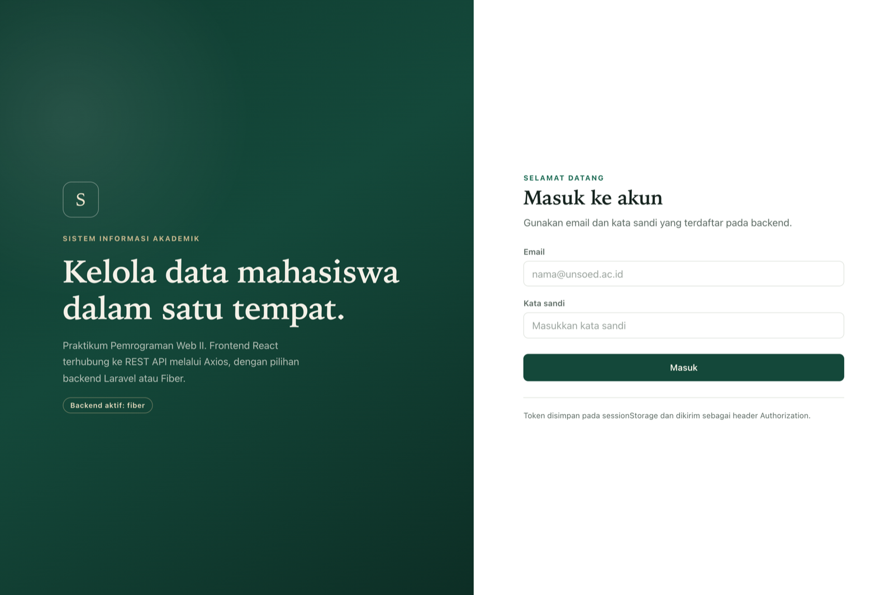

Gambar 2. Login dengan kata sandi salah, pesan galat dari server ditampilkan (401)


Gambar 3. Daftar mahasiswa termuat setelah login berhasil (200)


Gambar 4. Pencarian "Eko" dengan penundaan 400 milidetik (200)


Gambar 5. Formulir tambah mahasiswa terbuka

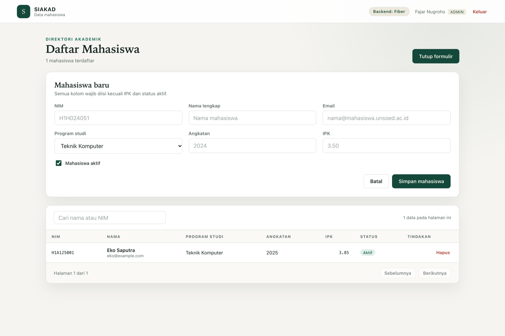

Gambar 6. Pesan galat validasi server tampil di bawah setiap kolom (422)

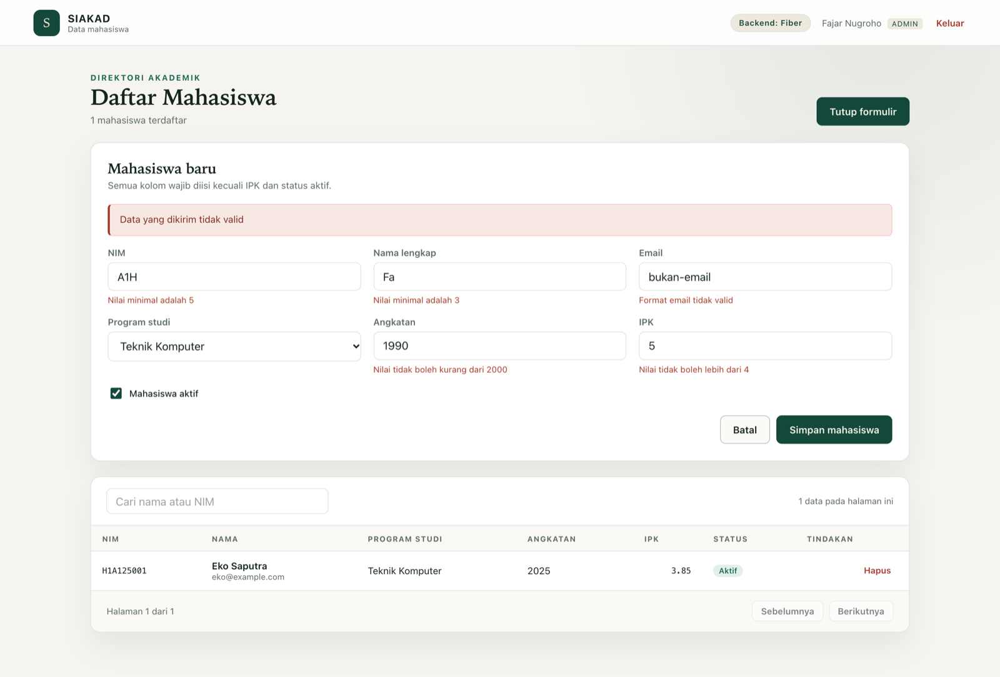

Gambar 7. Data baru muncul pada daftar setelah penyimpanan berhasil (201)

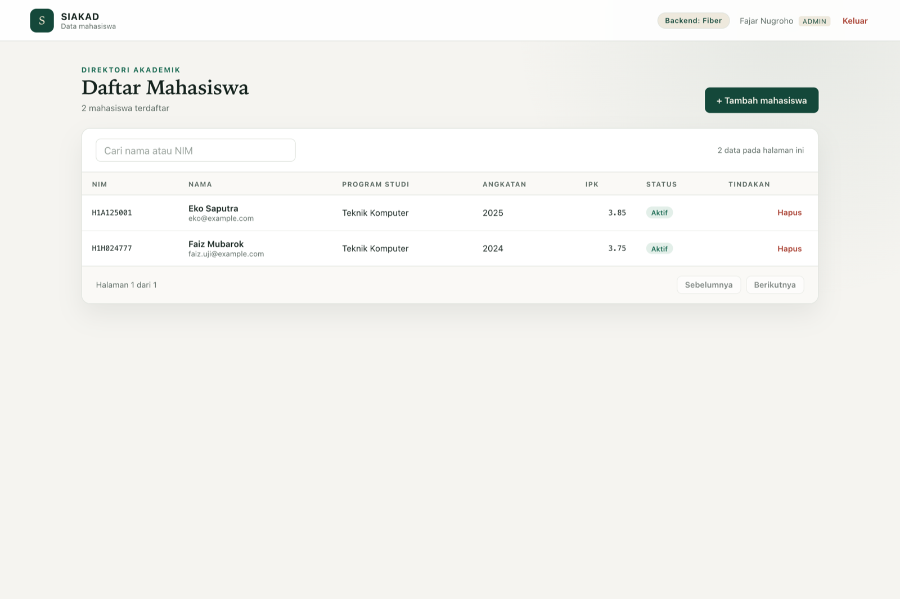

Gambar 8. Dialog konfirmasi sebelum data dihapus

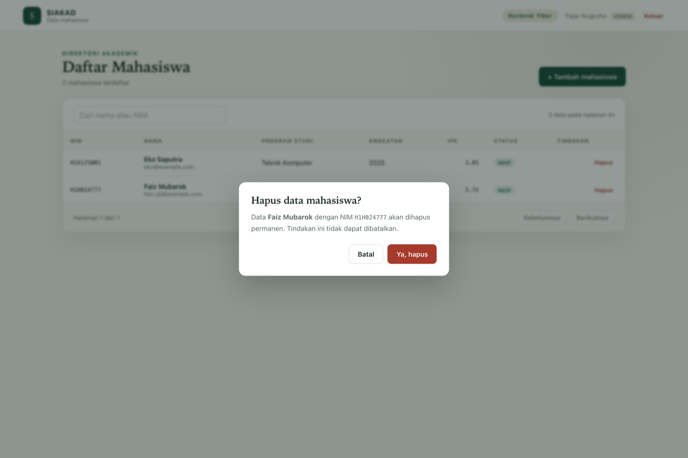

Gambar 9. Daftar dimuat ulang setelah penghapusan berhasil (200)

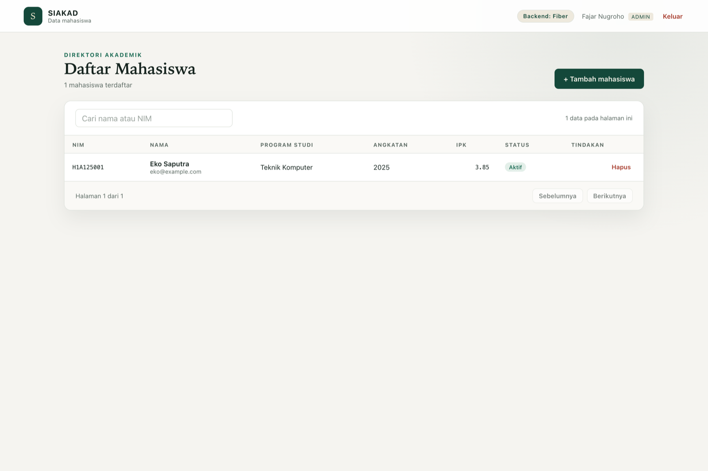

Gambar 10. Antarmuka yang sama setelah `VITE_API_TARGET` diubah menjadi Laravel, tanpa perubahan kode

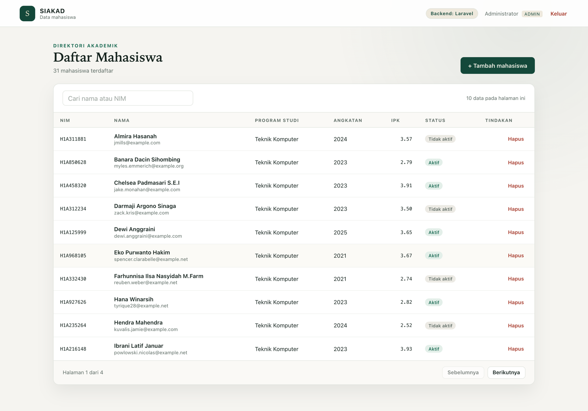

Gambar 11. Pesan validasi backend Laravel pada formulir yang sama

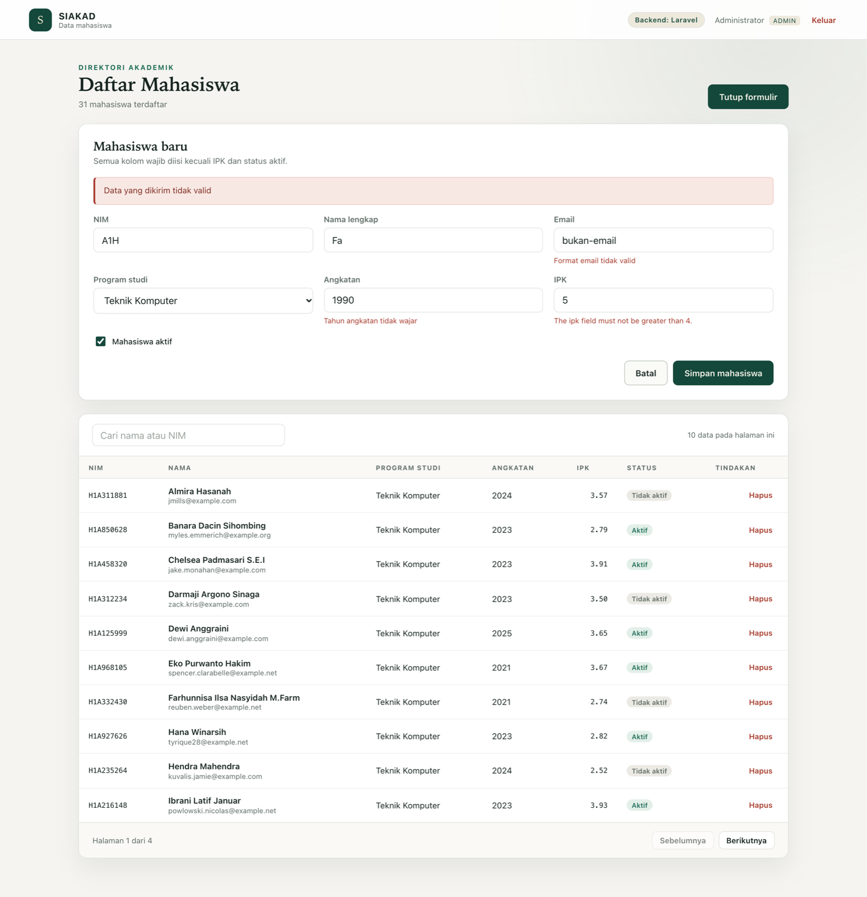

Gambar 12. Preflight `OPTIONS` pada Laravel (204)

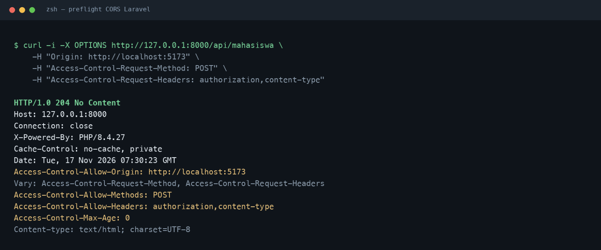

Gambar 13. Preflight `OPTIONS` pada Fiber (204)

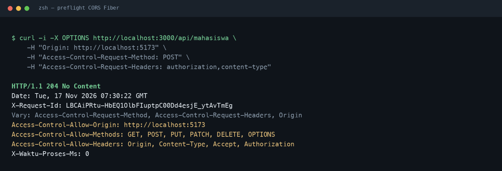

Gambar 14. Konsol peramban ketika origin tidak diizinkan

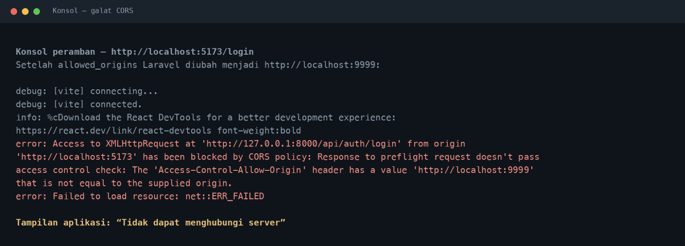

Gambar 15. Tampilan aplikasi ketika permintaan diblokir CORS

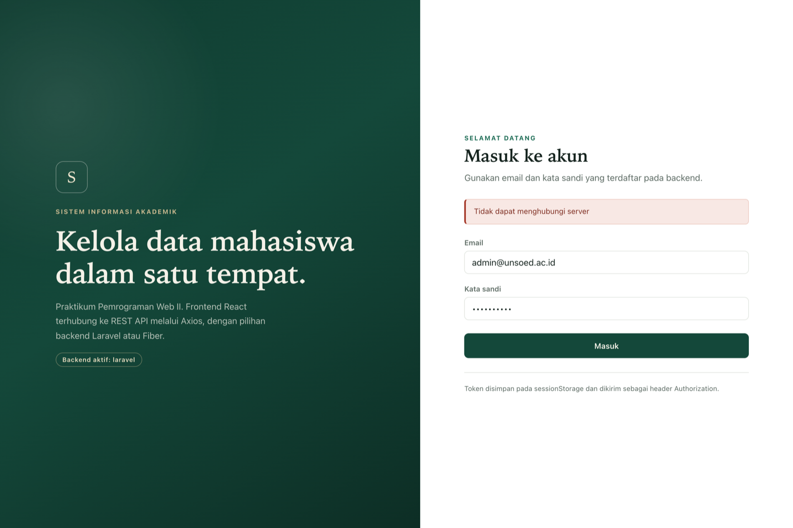

Gambar 16. Ringkasan lalu lintas jaringan saat tambah dan hapus data

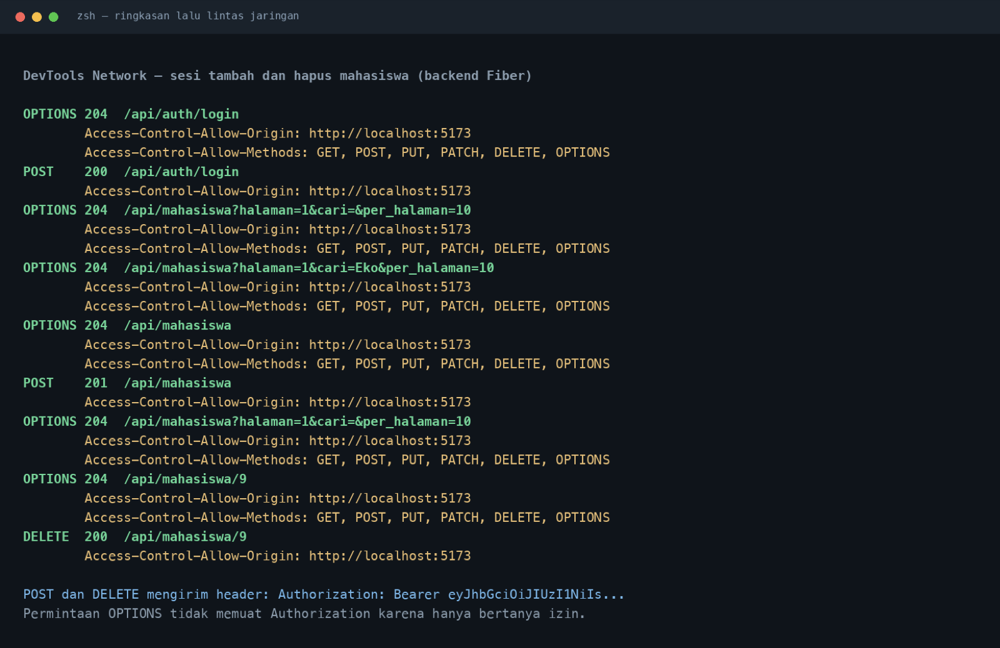

Gambar 17. Struktur respons daftar dari Laravel

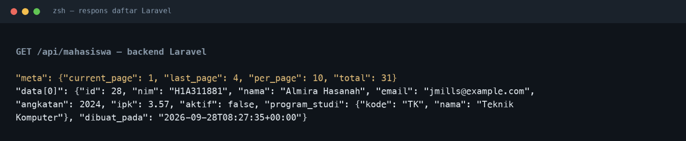

Gambar 18. Struktur respons daftar dari Fiber

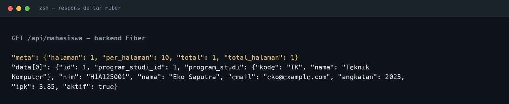

Gambar 19. Hasil `npm run build` untuk frontend

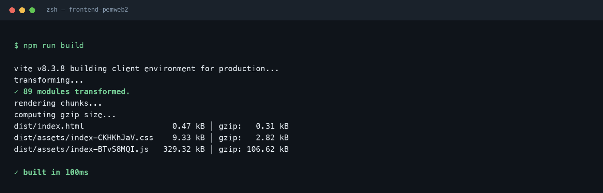

| Uji | Permintaan | Status | Hasil |
|-----|-----------|--------|-------|
| Login salah | POST /api/auth/login kata sandi salah | 401 | pesan "Email atau kata sandi tidak sesuai" |
| Login benar | POST /api/auth/login kredensial benar | 200 | token disimpan pada sessionStorage |
| Daftar Fiber | GET /api/mahasiswa?halaman=1&per_halaman=10 | 200 | data dan meta halaman tampil |
| Pencarian | GET /api/mahasiswa?cari=Eko | 200 | hanya Eko Saputra tampil |
| Tambah valid | POST /api/mahasiswa data lengkap | 201 | Faiz Mubarok muncul pada daftar |
| Tambah tidak valid | POST /api/mahasiswa NIM `A1H`, email salah | 422 | lima pesan galat per field |
| Hapus | DELETE /api/mahasiswa/9 | 200 | baris hilang dan daftar dimuat ulang |
| Ganti backend | `VITE_API_TARGET=laravel` | 200 | 31 data, empat halaman, tanpa ubah kode |
| Validasi Laravel | POST /api/mahasiswa IPK 5 | 422 | pesan per field, sebagian masih Inggris |
| Preflight Laravel | OPTIONS /api/mahasiswa | 204 | ACAO 5173, metode POST |
| Preflight Fiber | OPTIONS /api/mahasiswa | 204 | ACAO 5173, metode lengkap |
| CORS ditolak | origin 5173, allowed 9999 | - | preflight gagal, UI "Tidak dapat menghubungi server" |
| Build | npm run build | - | 89 modul, bundel 329 kB |

## Pertanyaan Pembahasan

1. Mengapa galat CORS tidak dapat diselesaikan dari sisi frontend?

   Kebijakan same origin dijalankan oleh peramban, bukan oleh kode JavaScript. Ketika server tidak mengirim header `Access-Control-Allow-Origin` yang cocok, peramban menahan respons dan menyerahkan galat jaringan ke halaman; kode frontend tidak pernah menerima isi respons untuk diperbaiki. Yang bisa dilakukan frontend hanyalah mengubah asal permintaan, misalnya memakai proxy pengembangan, tetapi pada lingkungan nyata keputusan tetap berada di server. Karena itu memperbaiki CORS berarti memperbaiki konfigurasi backend, bukan menambah header di Axios. Menonaktifkan CORS melalui ekstensi peramban hanya menyembunyikan gejala pada komputer pengembang dan tidak menyelesaikan masalah bagi pengguna lain. Percobaan pada Gambar 14 dan Gambar 15 menunjukkan hal itu: permintaan berhenti pada preflight sebelum handler Laravel dijalankan.

2. Jelaskan kelebihan dan kekurangan penyimpanan token pada sessionStorage dibandingkan cookie HttpOnly.

   `sessionStorage` mudah dibaca JavaScript sehingga penyisipan header `Authorization` menjadi sederhana dan tidak memicu pengiriman otomatis pada permintaan lintas situs. Kelemahannya, skrip yang berhasil masuk lewat celah XSS dapat membaca token dan mengirimkannya ke penyerang. Sesi juga berakhir ketika tab ditutup dan token tidak tersedia pada tab lain, sehingga pengguna harus login lagi. Cookie `HttpOnly` tidak dapat dibaca JavaScript sehingga menahan pencurian token lewat XSS, dan dapat diberi atribut `Secure` serta `SameSite` untuk membatasi pengiriman. Namun cookie dikirim otomatis pada setiap permintaan ke domain yang sama sehingga rawan CSRF bila `SameSite` tidak diatur, dan frontend lintas origin memerlukan `credentials: 'include'` serta `supports_credentials` pada server. Untuk API lintas origin dengan token Bearer seperti praktikum ini, `sessionStorage` lebih sederhana; untuk aplikasi yang menyimpan sesi pengguna jangka panjang, cookie `HttpOnly` dengan proteksi CSRF lebih aman.

3. Apa fungsi interceptor pada Axios dan masalah apa yang dicegah olehnya?

   Interceptor adalah fungsi yang dijalankan sebelum permintaan dikirim atau sesudah respons diterima. Interceptor permintaan pada praktikum ini menyisipkan token Bearer ke setiap panggilan sehingga penulisan header tidak diulang di setiap halaman dan tidak ada panggilan yang lupa memakai token. Interceptor respons memusatkan penanganan status `401`: token yang kedaluwarsa dihapus dan pengguna diarahkan ke halaman login, sehingga halaman tidak perlu menangani kasus yang sama berulang kali. Tanpa interceptor, logika itu mudah terlewat pada satu layanan dan menimbulkan keadaan setengah terautentikasi. Interceptor juga dapat menormalkan galat, mencatat waktu respons, atau mengulang permintaan tertentu. Yang perlu dipahami, interceptor tidak dapat memperbaiki CORS karena penolakan terjadi sebelum respons dapat dibaca; ia hanya menangani galat yang sudah sampai ke Axios.

4. Mengapa penanganan status memuat dan galat penting bagi pengalaman pengguna?

   Permintaan jaringan memerlukan waktu dan dapat gagal karena server mati, token kedaluwarsa, atau validasi tidak lolos. Tanpa status memuat, pengguna mengira tombol tidak bekerja lalu menekan berulang kali, yang dapat menghasilkan data ganda atau beberapa permintaan sekaligus. Indikator memuat dan tombol yang dinonaktifkan memberi kepastian bahwa sistem sedang bekerja. Tanpa penanganan galat, kegagalan server terlihat sama dengan daftar kosong sehingga pengguna menyimpulkan datanya hilang. Pemisahan keadaan memuat, galat, dan kosong membuat pesan yang ditampilkan sesuai sebabnya. Pada formulir, pesan galat per field mempercepat perbaikan karena pengguna langsung tahu kolom mana yang salah. Penanganan yang konsisten juga membantu aksesibilitas karena pesan dapat diumumkan pembaca layar dan fokus dapat diarahkan ke kolom bermasalah.
